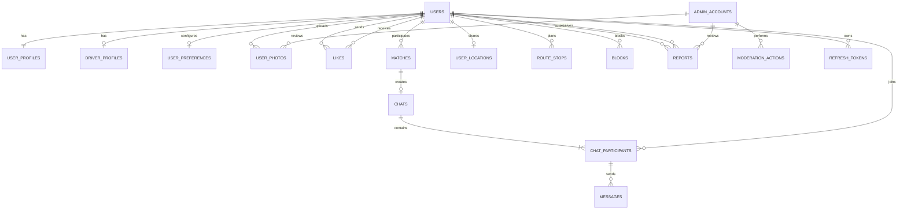

# TruckDating — Database

<p align="center">
  <strong>Database design for TruckDating</strong>
  <br />
  A social and dating platform for truck drivers across Europe.
</p>

<p align="center">
  
  
  
  
</p>

---

## Overview

TruckDating uses PostgreSQL as its primary relational database.

The database supports:

- User accounts and profiles
- Optional truck driver profiles
- Profile photos
- User preferences and discovery
- Likes and mutual matches
- Private chats and messages
- Current user locations
- Planned route stops
- Blocking and reporting
- Admin accounts and moderation
- Authentication refresh tokens

## Database Architecture



## Tables

| Table | Description |
|---|---|
| `users` | Main user accounts |
| `user_profiles` | Personal profile information |
| `driver_profiles` | Optional truck driver information |
| `user_preferences` | Discovery and matching preferences |
| `user_photos` | Profile photos and moderation status |
| `likes` | User likes |
| `matches` | Mutual likes |
| `chats` | Conversations between matched users |
| `chat_participants` | Users who participate in a chat |
| `messages` | Chat messages |
| `user_locations` | Current shared location |
| `route_stops` | Planned route stops |
| `blocks` | Blocked users |
| `reports` | User reports |
| `admin_accounts` | Separate administrator accounts |
| `moderation_actions` | Admin moderation history |
| `refresh_tokens` | Authentication refresh tokens |

## Account Model

There are two separate account types:

**User**
- Used by the Flutter mobile application.
- Every user has one general profile.
- A user may optionally have a driver profile.
- Users can discover, like, match and chat.

**AdminAccount**
- Used by the WPF Admin Panel.
- Separate from regular user accounts.
- Used for moderation and administration.

A truck driver is not a separate account role. It is a regular user with an optional `driver_profiles` record.

## Technology

| Component | Technology |
|---|---|
| Database | PostgreSQL |
| Geolocation | PostGIS |
| Backend | ASP.NET Core Web API |
| ORM | Entity Framework Core |
| PostgreSQL Provider | Npgsql |
| Mobile Application | Flutter |
| Admin Panel | C# / WPF / MVVM |

## Setup

### 1. Create a database

Create an empty PostgreSQL database named:

```sql
CREATE DATABASE truckdating;
```

### 2. Execute the schema

Open `schema.sql` in pgAdmin or another PostgreSQL client and execute the script while connected to the `truckdating` database.

### 3. Verify tables

```sql
SELECT table_name
FROM information_schema.tables
WHERE table_schema = 'public'
ORDER BY table_name;
```

## Important Notes

- Passwords must be stored as secure password hashes.
- Refresh tokens must be stored as hashes, not raw tokens.
- Profile photos are stored in external object storage. PostgreSQL stores their storage keys.
- Location sharing should be optional and controlled by the user.
- The backend is responsible for validating access, age restrictions and business rules.
- The mobile app and admin panel must access the database only through the backend API.

---

<p align="center">
  <strong>TruckDating</strong>
  <br />
  Database documentation
</p>
## Documentation

- [Database](docs/database/README.md)
- [WPF Admin Panel Use Cases](docs/use-cases/admin-panel.md)
- [Flutter Mobile App Use Cases](docs/use-cases/mobile-app.md)
